# 面向移动机器人远程巡检的低延时视频回传系统

基于 C++14/Linux 实现的端到端实时视频系统，覆盖摄像头采集、像素格式转换、H.264 编码、TCP/UDP/RTP 传输、弱网恢复、FFmpeg 解码与 OpenGL 渲染。项目面向移动机器人远程巡检中的实时画面回传需求，同时提供无摄像头测试源、自动化测试和分阶段延迟观测能力。

**核心技术：** `C++14` `Linux` `V4L2` `x264` `H.264 Annex-B` `TCP/UDP/RTP` `NACK` `XOR FEC` `Jitter Buffer` `FFmpeg` `OpenGL` `多线程`

## 项目亮点

- 打通 `V4L2 -> YUYV422 -> I420 -> x264 -> H.264 -> 网络 -> FFmpeg -> YUV -> OpenGL` 完整链路。
- 统一抽象 TCP、私有 UDP 和标准 RTP 三种传输后端，编码模块无需感知具体协议。
- TCP 使用消息头解决字节流边界，通过 `sendmsg + iovec` 分散写减少大块数据拼接。
- UDP 使用可配置 payload 上限进行应用层分片，支持乱序重组、重复包过滤、超时清理、NACK 重传和 XOR FEC 单分片恢复。
- RTP 按 H.264 over RTP 规则处理单 NALU 与 FU-A 分片，使用 sequence number、timestamp、marker bit 和 SSRC 恢复视频帧。
- 客户端采用网络、解码、渲染三线程流水线与有界队列，通过丢弃过期帧控制延迟积累。
- FFmpeg 解码帧使用引用计数跨线程传递，避免整帧深拷贝；OpenGL shader 在 GPU 完成 YUV 到 RGB。
- HUD 与日志统计采集到显示、网络接收、解码、渲染、丢包、NACK/FEC 和抖动缓冲状态。

## 系统架构

```mermaid
flowchart LR
    subgraph Device["机器人设备端 / sserver"]
        Camera["USB Camera"] --> V4L2["V4L2 + MMAP"]
        V4L2 --> YUYV["YUYV422"]
        YUYV --> I420["I420 / YUV420P"]
        I420 --> X264["x264 Low-Latency Encode"]
        X264 --> H264["H.264 Annex-B"]
        H264 --> Transport["TCP / UDP / RTP"]
    end

    Transport --> Network["LAN / Wi-Fi"]

    subgraph Client["远程监控端 / sclient"]
        Network --> Receive["Receive + Reassembly"]
        Receive --> Decode["FFmpeg H.264 Decode"]
        Decode --> YUV["YUV420P / NV12"]
        YUV --> Render["OpenGL Render + HUD"]
    end
```



## 数据链路

1. 服务端查询摄像头能力，配置分辨率、帧率和 YUYV 像素格式。
2. V4L2 申请 MMAP 缓冲区，通过 `DQBUF/QBUF` 循环取得原始帧。
3. 将 YUYV422 转换为 x264 接收的 I420，并进行 4:2:0 色度下采样。
4. x264 使用低延迟参数输出带 SPS/PPS、IDR 和普通 Slice 的 H.264 Annex-B 码流。
5. 传输层根据配置选择 TCP、UDP 或 RTP，对编码帧进行封装、分片和发送。
6. 客户端按协议读取或重组完整 H.264 帧，并在弱网下执行恢复与超时策略。
7. FFmpeg `libavcodec` 将 H.264 解码为 YUV420P/NV12，通过引用计数交给渲染线程。
8. OpenGL 上传 Y、U、V 或 Y、UV 纹理，在 fragment shader 中完成 YUV 到 RGB 并显示 HUD。

## 三种传输模式

| 模式 | 数据边界 | 可靠性策略 | 适用场景 |
|---|---|---|---|
| TCP | 自定义消息头 + payload 长度 | TCP 可靠有序；发送队列积压时主动丢弃过期非关键帧 | 网络稳定、优先完整性 |
| UDP | 自定义帧号、分片号、偏移量和时间戳 | NACK、重传缓存、XOR FEC、乱序重组、Jitter Buffer | Wi-Fi/弱网、优先低延迟 |
| RTP | 标准 RTP Header + H.264 payload | sequence number 检测丢包；单 NALU/FU-A 重组 | 标准协议对接和后续扩展 |

UDP 提供三档配置：

| Profile | Payload | NACK | FEC | 目标 |
|---|---:|---:|---:|---|
| `balanced` | 65000 B | 关闭 | 关闭 | 本地或稳定局域网的最低应用层处理开销，可能依赖 IP 分片 |
| `adaptive` | 1000 B | 关闭 | 开启 | Wi-Fi 轻度丢包下直接恢复单分片 |
| `resilient` | 256 B | 开启 | 开启 | 较差网络下优先保证可恢复性并降低 IP 分片风险 |

## 实测结果

测试日期：2026-07-23。环境为同一台 Windows 主机上的 WSL2，USB 摄像头通过 USB/IP 挂载；画面为 640x480，统计窗口 120 帧，客户端启用 FFmpeg 软件解码、OpenGL 渲染并关闭 VSync。UDP 使用 `resilient` 配置。以下数据用于展示链路分段观测能力，不代表原生 Linux 或真实无线网络的极限性能。

| 模式 | 网络到接收平均 | 解码平均 / P95 | 接收到渲染平均 / P95 | 端到端平均 |
|---|---:|---:|---:|---:|
| TCP | 0.71 ms | 0.44 / 1.03 ms | 6.40 / 7.01 ms | 204.97 ms |
| UDP | 0.24 ms | 0.47 / 1.11 ms | 6.25 / 7.50 ms | 234.62 ms |
| RTP | 0.08 ms | 0.48 / 1.02 ms | 6.19 / 7.36 ms | 204.08 ms |

端到端约 200 ms 的主要原因是 USB/IP 摄像头在 WSL2 下实际只有约 4.6–5 fps，即采集周期接近 200 ms；客户端从收包到显示平均约 6.2–6.4 ms。UDP 这一轮端到端值更高，但网络到接收仅 0.24 ms，差异主要发生在采集/编码前段，单轮 WSL2 数据不能直接归因于协议。三种模式的 FFmpeg 解码平均都低于 0.5 ms。

TCP/UDP 客户端在服务端启动后接入，首个关键帧到达前可能出现少量 `non-existing PPS` 提示，收到下一组 SPS/PPS/IDR 后会自动恢复；RTP 测试采用先监听后推流，避免错过流起始参数集。

弱网注入测试：

- 单分片丢失场景注入 12 个丢失分片，XOR FEC 恢复 12 个分片，最终统计分片丢失率为 0%。
- 突发丢失场景注入 42 个丢失分片，FEC 恢复 14 个，并发送 14 次 NACK 请求共请求 28 个分片，最终无超时帧且统计分片丢失率为 0%。

原始测试日志和资源采集文件属于本地运行产物，默认不提交到仓库；复现实验可使用 `benchmark-results/run_protocol_benchmark.sh` 的同类测试流程。

## 目录结构

```text
.
├── sserver/                  # 设备端：采集、编码、传输
│   ├── config/               # TCP/UDP/RTP 与测试配置
│   ├── docs/                 # 服务端架构和启动文档
│   ├── scripts/              # 构建、测试和启动脚本
│   ├── src/
│   │   ├── modules/capture/  # V4L2/Null 采集
│   │   ├── modules/encoding/ # x264 编码
│   │   └── modules/transport/# TCP/UDP/RTP 传输
│   └── tests/                # 单元、集成、冒烟和基准测试
├── sclient/                  # 监控端：接收、解码、渲染
│   ├── docs/                 # 客户端架构与 FFmpeg 面试文档
│   ├── scripts/              # TCP/UDP/RTP 启动脚本
│   ├── src/
│   │   ├── modules/network/  # 三种协议接收与重组
│   │   ├── modules/decoding/ # FFmpeg 软件解码
│   │   └── modules/rendering/# OpenGL + ImGui HUD
│   └── tests/
└── README.md
```

项目包含约 2.6 万行 C/C++ 代码与分层测试。

## 环境依赖

推荐 Ubuntu 22.04/24.04 或其他具备 V4L2 的 Linux 环境：

```bash
sudo apt update
sudo apt install -y \
  build-essential cmake pkg-config \
  libx264-dev \
  libavcodec-dev libavutil-dev libswscale-dev \
  libglfw3-dev libgl-dev \
  ffmpeg v4l-utils
```

OpenCV 只用于部分可选测试，不是主链路的必要依赖。

## 构建

服务端和客户端分别构建：

```bash
cmake -S sserver -B sserver/build -DCMAKE_BUILD_TYPE=Release
cmake --build sserver/build -j

cmake -S sclient -B sclient/build -DCMAKE_BUILD_TYPE=Release
cmake --build sclient/build -j
```

## 快速运行

### 1. 无摄像头验证 TCP 链路

终端 1：

```bash
cd sserver
./build/stream_server --config config/null_tcp.conf
```

终端 2：

```bash
cd sclient
./scripts/tcp.sh
```

### 2. 使用 V4L2 摄像头

先确认设备与格式：

```bash
v4l2-ctl --list-devices
v4l2-ctl --device=/dev/video0 --list-formats-ext
```

再分别启动服务端和客户端：

```bash
cd sserver && ./scripts/tcp.sh
cd sclient && ./scripts/tcp.sh
```

UDP 和 RTP 的完整启动组合见 [服务端启动指南](sserver/docs/start.md)。

## 测试

```bash
ctest --test-dir sserver/build --output-on-failure
ctest --test-dir sclient/build --output-on-failure
```

测试覆盖：

- 配置加载和异常配置；
- RTP Header、SDP 与 H.264 packetization；
- TCP/UDP/RTP loopback 集成链路；
- UDP FEC 恢复、NACK/FEC 组合；
- 有界线程安全队列和延迟统计；
- H.264 RTP 接收与 FFmpeg 解码冒烟测试；
- V4L2 硬件测试在无设备时可跳过。

## 关键设计取舍

### 为什么同时实现 TCP、UDP 和 RTP

三者对应不同工程目标：TCP 提供可靠有序字节流，但可能出现重传与队头阻塞；UDP 提供更低的传输约束，但需要应用层自行解决分片、丢包和乱序；RTP 在 UDP 上提供标准化的序号、媒体时间戳和 H.264 分片规则，适合协议兼容。

### 为什么实时视频允许丢帧

实时监控更关注“现在发生了什么”。当生产速度长期高于消费速度时，无限排队虽然保留了历史帧，却会让画面越来越落后。因此项目使用有界队列、关键帧识别和过期帧丢弃，在完整性与实时性之间取舍。

### 为什么解码后不深拷贝整帧

FFmpeg 的 `AVFrame` 底层缓冲区支持引用计数。客户端通过 `av_frame_clone` 和智能指针管理生命周期，把平面指针安全交给渲染线程，避免每帧复制约 `width * height * 1.5` 字节的 YUV 数据。

## 已知限制与后续方向

- 当前只处理视频，不包含音频采集、编解码和音视频同步。
- RTP 已实现 H.264 单 NALU/FU-A 和基础接收统计，尚未形成完整 RTCP、RTP NACK 或拥塞控制协议栈。
- UDP XOR FEC 只能在一个保护组内直接恢复单个缺失分片，多分片丢失需要 NACK 或等待关键帧。
- 当前为 FFmpeg 软件解码，后续可增加 VAAPI/NVDEC 等硬件后端并探索 GPU 零拷贝渲染。
- WSL2 USB/IP 不适合评价摄像头原生采集性能，正式性能结论应在原生 Linux 和真实无线网络中复测。

## 文档导航

- [服务端启动指南](sserver/docs/start.md)
- [服务端源码架构](sserver/docs/src_architecture_overview.md)
- [服务端文档索引](sserver/docs/README_INDEX.md)
- [客户端源码架构](sclient/docs/src_architecture_overview.md)
- [客户端文档索引](sclient/docs/README_INDEX.md)
- [FFmpeg 基础知识与项目面试指南](sclient/docs/ffmpeg_interview_guide.md)

## 面试介绍参考

> 这是一个面向移动机器人远程巡检的视频回传系统。我在 Linux 下打通了从 V4L2 摄像头采集、YUYV 到 I420 转换、x264 低延迟编码，到 TCP/UDP/RTP 网络传输，再到客户端 FFmpeg 解码和 OpenGL 渲染的完整链路。项目重点不只是把画面传出来，还围绕实时性处理了队列积压、UDP 分片乱序、NACK 重传、XOR FEC 和网络抖动，并通过贯穿采集到显示的时间戳与 HUD 指标定位瓶颈。实测中客户端收包后的解码渲染约为 6–8 ms，而 WSL2 USB/IP 摄像头限制使端到端约为 200 ms，这让我能够把环境采集瓶颈和系统处理延迟区分开来。
